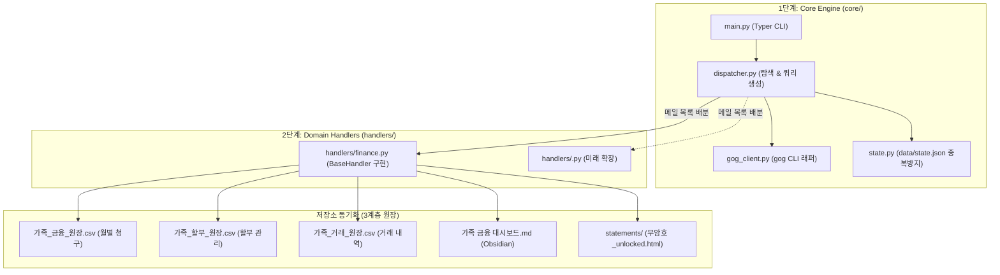

# AGENTS.md (mail-sync)

이 문서는 `mail-sync` 도구를 유지보수하고 새로운 메일 처리 핸들러(Handler)를 추가할 AI 에이전트들을 위한 도메인 특화 아키텍처 가이드이자 단일 진실 공급원(SSOT)입니다.

---

## 1. 아키텍처 개요 (2-Tier Architecture)

`mail-sync`는 **1단계 코어 디스패처(Filter & Deduplication)**와 **2단계 플러그인 핸들러(Domain Processor)**로 엄격하게 계층화되어 있습니다.



---

## 2. 신규 핸들러 추가 가이드 (Adding a New Handler)

새로운 도메인의 메일(예: 자동차세/지방세 `tax.py`, 증권 리포트 `stock.py` 등)을 추가할 때는 코어 코드를 수정할 필요 없이 `src/handlers/` 아래에 `BaseHandler`를 구현한 파이썬 파일을 추가하기만 하면 됩니다.

### 2.1 핸들러 인터페이스 명세
```python
# src/handlers/tax.py 예시
from typing import Any, Callable, Dict, List, Optional
import typer
from core.base import BaseHandler, HandlerResult
from core.config import MailSyncConfig

class TaxHandler(BaseHandler):
    name = "tax"
    description = "지방세 및 국세 고지서 메일 자동 수집"

    def get_gmail_query(self, time_window_str: Optional[str] = None, month_str: Optional[str] = None) -> str:
        # 1단계 검색 쿼리 정의
        q = "from:wetax.go.kr (고지서 OR 납부안내)"
        if time_window_str:
            q += f" {time_window_str}"
        return q

    def process(
        self,
        messages: List[Dict[str, Any]],
        config: MailSyncConfig,
        progress_callback: Optional[Callable[[str, Optional[float]], None]] = None,
    ) -> HandlerResult:
        # 2단계: 메일 파싱, 파일 저장, 시트/마크다운 갱신
        processed = []
        for msg in messages:
            # 처리 로직...
            pass
        return HandlerResult(handler_name=self.name, success=True, processed_count=len(processed), items=processed)

    def register_cli(self, sub_app: typer.Typer) -> None:
        # (선택) CLI 명령어 등록 (예: mail-sync tax list)
        @sub_app.command("list")
        def list_tax():
            pass
```

---

## 3. `finance` 핸들러 핵심 파서 및 복호화 규칙

### 3.1 우리은행 대출 메일 (`_parse_woori_loan`)
* **식별**: `from:wooribank.com` 및 제목 내 `이자납입기일` 또는 `대출`.
* **파싱**: 본문 HTML 내 `<table>`의 `<th>`/`<td>` 쌍 탐색:
  * `원금`: `769,450` ➔ 숫자 추출
  * `이자`: `589,479` ➔ 숫자 추출
  * `이율`: `3.26%`
  * `이자납입일`: `26년10월15일` ➔ `2026-10-15` 정규화
* **특징**: 암호화되어 있지 않으므로 브라우저 없이 BeautifulSoup으로 100% 즉시 파싱.

### 3.2 카드 3사 보안 HTML 복호화 및 세부 내역 추출 (`_decrypt_html_and_extract_details`)
* **식별**:
  * 삼성카드: `from:samsungcard.com`, 첨부 `samsungcard_detail_*.html` (VestMail)
  * 현대카드: `from:hyundaicard.com`, 첨부 `hyundaicard_*.html`
  * 우리카드: `from:wooricard.com`, 첨부 `WooriCard.html`
* **복호화 엔진**: Playwright 헤드리스 Chromium (`playwright install chromium`)
* **동작 원리**:
  1. `file://<html_path>` 로컬 파일 로드.
  2. `input[type="password"]` 요소에 `config.birth_date_6digit` 자동 주입 후 전송.
  3. 우리카드의 경우 `카드이용내역` 탭 클릭하여 전체 12건 거래 노출.
  4. 렌더링 완료된 DOM HTML을 `statements/YYYY-MM/<카드사>_YYYY-MM_unlocked.html`로 저장 (비밀번호 없는 1클릭 조회용).
  5. 본문 텍스트에서 실제 출금계좌(`새마을금고`, `토스뱅크`, `우리은행`), 청구 총액, 할부 상세(`_parse_samsung_details`), 개별 거래내역 추출.
  6. 복호화 실패 시: 예외를 던지지 않고 원본 첨부파일 보존 후 `PENDING` 기록 (Fail-safe).

---

## 4. 데이터 스키마 및 저장 원칙 (3계층 원장)

1. **`가족_금융_원장.csv` (월별 청구 원장 / `monthly_bills`)**:
   * 컬럼: `id`, `due_date`, `billing_month`, `category`, `institution`, `item_name`, `principal`, `interest`, `total_amount`, `interest_rate`, `withdrawal_account`, `status`, `statement_url`, `updated_at`
2. **`가족_할부_원장.csv` (할부 종합 관리 원장 / `installments`)**:
   * 컬럼: `id`, `card_company`, `merchant_name`, `start_date`, `total_amount`, `total_rounds`, `current_round`, `remaining_rounds`, `billed_this_month`, `remaining_principal`, `status`, `billing_month`, `updated_at`
3. **`가족_거래_원장.csv` (개별 거래 상세 원장 / `transactions`)**:
   * 컬럼: `id`, `transaction_date`, `card_company`, `card_last4`, `merchant_name`, `category`, `original_amount`, `discount_amount`, `billed_amount`, `installment_plan`, `status`, `source`, `billing_month`, `reconciled_at`
4. **`webhook_gas.js` (모바일 가계부 App 연동 Webhook)**:
   * Google Apps Script로 Google Sheets에 배포하여 모바일 앱 문자/푸시 파싱 결과를 `transactions` 시트에 HTTP POST로 실시간 등록.
5. **`가족 금융 대시보드.md` (Obsidian Dashboard)**:
   * 매 실행 시 `updated: YYYY-MM-DD` 갱신.
   * 출금 계좌별 분리 준비 자금(새마을금고, 토스뱅크, 우리은행) 및 잔여 할부 관리 현황 브리핑.

---

## 5. 수정 시 주의사항 (Dont's)

* ⚠️ **`data/state.json` 직접 임의 수정 금지**: `StateManager` 클래스를 통해서만 `is_processed`, `mark_processed`를 호출해야 원자적(Atomic) 저장이 보장됩니다.
* ⚠️ **`.env` 및 생년월일 Git 커밋 엄격 금지**: `BIRTH_DATE_6DIGIT`는 민감 개인정보이므로 커밋에 절대 포함되어서는 안 됩니다.
* ⚠️ **경로 하드코딩 금지**: 로컬 머신 절대 경로를 코드에 직접 적지 말고 `MailSyncConfig`의 동적 자동 탐색(`find_default_obsidian_family_path`)을 사용해야 서버/다른 머신에서도 깨지지 않습니다.
